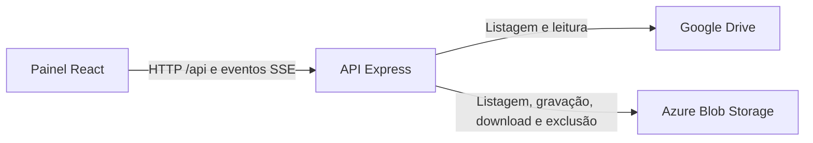

# Migração Google Drive → Azure Blob Storage

Aplicação web para copiar arquivos de uma pasta do Google Drive para um contêiner privado do Azure Blob Storage. O painel permite selecionar arquivos, acompanhar a cópia e gerenciar os blobs de destino.

[Configuração](#variáveis-locais) · [Execução local](#execução-local) · [Operação do painel](#como-usar-o-painel) · [API](#operação-e-api) · [Deploy](#publicação-no-azure-app-service)

## Arquitetura



- `frontend/` contém o painel React com TypeScript e Vite. Durante o desenvolvimento, o Vite encaminha requisições de `/api` ao Express.
- `backend/src/` contém a API, a autenticação administrativa e as integrações oficiais do Google e do Azure. A chave da conta de serviço e a connection string são lidas somente pelo backend.
- `backend/test/` contém os testes Vitest com integrações simuladas.
- Em produção, o Express serve a API e o frontend compilado na mesma origem.

## Requisitos

- Node.js 22.12 ou superior e npm.
- Projeto Google Cloud com Drive API, Service Account e pasta compartilhada com ela.
- Conta Azure Storage com acesso a Blob Storage. Para publicar, uma assinatura Azure e um App Service Linux com runtime Node.js.

## Configuração do Google Drive

1. Abra o Google Cloud Console e selecione ou crie um projeto.
2. Em **APIs e serviços → Biblioteca**, procure **Google Drive API** e clique em **Ativar**.
3. Em **IAM e administrador → Contas de serviço**, crie uma conta dedicada. O acesso aos arquivos vem do compartilhamento no Drive.
4. Na conta, abra **Chaves → Adicionar chave → Criar nova chave → JSON**, se permitido pela organização. Guarde temporariamente o arquivo fora do repositório e insira seu conteúdo em `GOOGLE_SERVICE_ACCOUNT_JSON` conforme a próxima seção.
5. No Google Drive, abra o compartilhamento da pasta e adicione o e-mail `client_email` da conta de serviço como **Leitor**. Confirme que a leitura e o download estão permitidos para os itens da pasta. O backend usa o escopo `drive.readonly`.
6. Copie o trecho após `/folders/` na URL da pasta, sem parâmetros, para `GOOGLE_DRIVE_FOLDER_ID`.

Referências. [Credenciais e contas de serviço](https://developers.google.com/workspace/guides/create-credentials) · [Download e exportação](https://developers.google.com/workspace/drive/api/guides/manage-downloads)

## Configuração do Azure Storage

No portal, abra **Conta de armazenamento → Segurança e rede → Chaves de acesso** e obtenha a connection string para o backend. A credencial precisa de acesso para listar, ler e gravar blobs. A ação Excluir requer permissão de exclusão. A criação automática também requer permissão para criar o contêiner. Se a credencial tiver acesso somente ao contêiner existente, crie-o no portal com acesso privado e use uma credencial que permita listar e escrever nele.

Configure o contêiner no formato `aluno-nome`, como `aluno-guilhermebispo`. O backend exige o prefixo `aluno-`. Use letras minúsculas, números e hífens simples. O comprimento máximo é de 63 caracteres. [Regras de nomenclatura do Azure](https://learn.microsoft.com/en-us/rest/api/storageservices/naming-and-referencing-containers--blobs--and-metadata)

## Variáveis locais

Copie o modelo na raiz com `Copy-Item .env.example .env` no PowerShell ou `cp .env.example .env` no Bash. Edite o arquivo local.

| Variável | Valor |
| --- | --- |
| `GOOGLE_DRIVE_FOLDER_ID` | ID da pasta compartilhada. |
| `GOOGLE_SERVICE_ACCOUNT_JSON` | Objeto JSON completo em uma linha, envolvido por aspas simples no `.env`. Preserve os `\n` literais dentro de `private_key`. |
| `AZURE_STORAGE_CONNECTION_STRING` | Connection string do Blob Storage. |
| `AZURE_CONTAINER_NAME` | `aluno-guilhermebispo` ou outro contêiner no formato `aluno-nome`. |
| `ADMIN_API_TOKEN` | Token aleatório com pelo menos 32 caracteres, sem espaços. |
| `PORT` | Opcional. O padrão é 3000. Em desenvolvimento, o proxy do Vite usa a mesma porta do Express em 127.0.0.1. |

### Gerar o token de administrador pelo terminal

Com o Node.js instalado, execute no terminal:

```powershell
node -e "console.log(require('node:crypto').randomBytes(32).toString('hex'))"
```

1. Copie o valor de 64 caracteres exibido no terminal.
2. No arquivo `.env`, substitua o valor de `ADMIN_API_TOKEN` pelo token gerado.
3. Inicie o backend. Se ele estiver rodando, reinicie-o para carregar o novo valor.
4. Abra o painel e cole o mesmo token no campo **Token de administrador**.

O painel mantém o token na memória da página e o envia no cabeçalho `Authorization`. Em produção, configure o token nas variáveis de ambiente do App Service e use HTTPS. Mantenha o `.env` e os arquivos de chave fora do Git.

## Execução local

Clone o repositório pelo endereço exibido em **Code** no GitHub e abra a pasta que contém o `package.json` no VS Code. Depois de configurar o `.env`, instale as dependências uma vez na raiz.

```powershell
npm.cmd ci
```

Abra dois terminais integrados nessa mesma pasta.

**Terminal 1 — Backend**

```powershell
npm.cmd run dev:api
```

Aguarde a mensagem `Servidor iniciado na porta 3000.`. Mantenha o terminal aberto.

**Terminal 2 — Frontend**

```powershell
npm.cmd run dev:web
```

Abra o [painel local](http://127.0.0.1:5173) depois que o Vite estiver pronto. A [rota de saúde pelo Vite](http://127.0.0.1:5173/api/health) deve mostrar `{"status":"ok"}`, o que confirma a comunicação com o Express. Em macOS ou Linux, use `npm` no lugar de `npm.cmd`.

Cada terminal controla um serviço. Use `Ctrl+C` em cada um para encerrar os dois. Se as portas estiverem livres, `npm.cmd run dev` também permite iniciá-los juntos.

### Testes e execução local em modo de produção

```powershell
npm.cmd test
npm.cmd run build
npm.cmd start
```

Os testes usam serviços simulados e podem ser executados sem credenciais reais. Antes de executar `npm.cmd start`, encerre o backend de desenvolvimento para liberar a porta. O Express serve o painel e a API em [127.0.0.1:3000](http://127.0.0.1:3000), ou na porta definida em `PORT`.

## Como usar o painel

1. No campo **Token de administrador**, digite o valor de `ADMIN_API_TOKEN` definido no seu `.env`.
2. Em **Origem**, clique em **Listar origem**. Use **Visualizar** na linha do arquivo para abri-lo no Google Drive. A conta Google do navegador precisa ter acesso ao arquivo.
3. Em **Destino**, clique em **Listar destino** para conferir o conteúdo atual do contêiner. A primeira consulta pode criá-lo se a credencial do Azure tiver essa permissão.
4. Em **Quando o blob já existir**, selecione **Ignorar arquivo** para preservar o conteúdo existente ou **Sobrescrever blob** para substituí-lo.
5. Escolha o que vai copiar.
   - **Todos os arquivos.** Clique em **Enviar todos** para copiar o conteúdo da pasta configurada, incluindo subpastas.
   - **Somente selecionados.** Marque os arquivos desejados em Origem e clique em **Enviar selecionados**. Cada envio por seleção aceita até 500 arquivos.
6. Acompanhe o progresso e o **Log de transferências**. O resumo mostra quantos arquivos foram processados, concluídos com sucesso, ignorados ou tiveram erro.
7. Clique em **Listar destino** de novo para atualizar o conteúdo exibido. O log também oferece Visualizar e Baixar para os arquivos copiados com sucesso.

### Ações no destino

| Ação | O que acontece |
| --- | --- |
| **Visualizar** | Abre a prévia de PDFs, texto simples e imagens compatíveis de até 20 MB. Para arquivos Office e outros formatos sem prévia, use **Baixar**. |
| **Baixar** | Salva uma cópia do blob no seu computador. |
| **Excluir** | Pede confirmação com o nome do blob e o remove do Azure. O arquivo de origem continua no Drive. A credencial precisa de permissão de exclusão. Snapshots ou políticas de retenção podem impedir a operação. |

## Solução de problemas

| Sintoma | O que verificar |
| --- | --- |
| **Porta 3000 ou 5173 já está em uso** | Procure um servidor de desenvolvimento que já esteja ativo. Encerre-o com `Ctrl+C` no terminal correspondente antes de iniciar outra instância. |
| **API indisponível ou ECONNREFUSED** | Confira se o backend anunciou a inicialização. Teste [a API direta](http://127.0.0.1:3000/api/health) e [a API pelo Vite](http://127.0.0.1:5173/api/health). Se alterou `PORT`, reinicie ambos e ajuste o endereço do teste direto. |
| **Token inválido ou ausente** | Digite no painel o mesmo valor configurado em `ADMIN_API_TOKEN`. Se alterou o token, reinicie o backend. |
| **Origem ausente ou sem acesso** | Confira o ID da pasta, se a Drive API está ativa e se a pasta foi compartilhada com o e-mail da conta de serviço. |
| **Acesso negado no Azure** | Confira a connection string, o nome do contêiner e a permissão exigida pela ação. |

No PowerShell, verifique quais processos estão escutando nas portas padrão. O PID aparece na última coluna. Sem saída, as portas estão livres.

```powershell
netstat -ano | Select-String ':(3000|5173)\s.*LISTENING'
```

## Operação e API

| Rota | Comportamento |
| --- | --- |
| `GET /api/health` | Público. Confirma que o processo HTTP está disponível. |
| `GET /api/drive/files` | Lista ID, nome, caminho, MIME, tamanho em bytes quando disponível e modificação. |
| `GET /api/azure/blobs` | Lista nome, tamanho em bytes e última modificação. Pode criar o contêiner privado. |
| `GET /api/azure/blobs/download?name=...` | Baixa um blob pelo nome completo. Adicione `preview=1` para obter a prévia de PDF, texto simples ou imagem compatível de até 20 MB. |
| `DELETE /api/azure/blobs?name=...` | Exclui do contêiner Azure o blob indicado pelo nome completo. Retorna 204. |
| `POST /api/migrations` | Recebe `{"duplicatePolicy":"skip"}` ou `{"duplicatePolicy":"overwrite"}`. Envie também `fileIds` com 1 a 500 IDs para copiar só os selecionados. Sem `fileIds`, copia a pasta inteira. Retorna 202 com o ID. |
| `GET /api/migrations/:id` | Consulta estado e resultados. |
| `GET /api/migrations/:id/events` | SSE autenticado. Envia um retrato inicial, mudanças individuais e o estado final. O painel consulta a rota de estado se o SSE for interrompido. |

As rotas com dados exigem `Authorization: Bearer <token>`. A criação aceita JSON de até 128 KB. Há uma migração ativa por processo e o histórico conserva as últimas 20 em memória. Reiniciar o serviço limpa o histórico e interrompe a operação em execução. Use **uma instância** do App Service e **um processo Node** para manter as consultas de estado na mesma instância que iniciou a migração.

- A cópia é recursiva, preserva caminhos relativos nos nomes dos blobs e processa os arquivos em sequência. Pastas vazias não geram blobs. Barras literais, porcentagens e pontos ou espaços no final de um segmento são codificados.
- Docs, Sheets e Slides são exportados para `.docx`, `.xlsx` e `.pptx`. A exportação do Drive tem limite de 10 MB. Atalhos e demais tipos nativos geram erro individual. O servidor consulta o Drive com permissão de leitura e mantém a origem intacta.
- **Ignorar** preserva o blob existente e aplica uma condição no upload para cobrir uma criação concorrente. **Sobrescrever** atualiza conteúdo e tipo MIME. Duplicidade usa o nome final do blob, inclusive extensão de exportação e caminho. Arquivos do Drive com o mesmo destino são processados na ordem de nome final e ID. Com **Ignorar**, prevalece o primeiro conteúdo já gravado. Com **Sobrescrever**, prevalece a última gravação bem-sucedida.
- O backend pagina as listagens e usa streams entre Drive e Azure. Falhas transitórias permitem até três tentativas na aplicação, com espera exponencial e jitter. As páginas usam limite de 30 segundos por tentativa e a cópia usa 10 minutos por tentativa. Os logs do console registram nome, status, duração e mensagem sanitizada de cada resultado.

## Publicação no Azure App Service

1. Crie um **Web App** Linux no Azure Portal, com stack Node.js 22 LTS ou 24 LTS, uma instância e **HTTPS Only** ativado. Em **Startup Command**, configure `npm start`.
2. Em **Configurações → Variáveis de ambiente → Configurações do aplicativo**, adicione as cinco variáveis da tabela. Cole o JSON em uma linha, sem as aspas simples externas usadas no `.env`. Adicione também `SCM_DO_BUILD_DURING_DEPLOYMENT=true` para que o Azure instale dependências e execute o build. Deixe o App Service fornecer `PORT`.
3. Com Azure CLI autenticada (`az login`), execute na raiz do projeto os comandos abaixo no PowerShell. O ZIP inclui apenas o código-fonte e os manifestos necessários.

```powershell
tar.exe -a -cf app.zip --exclude=dist package.json package-lock.json backend frontend
az webapp deploy --resource-group MEU_GRUPO --name MEU_APP --src-path app.zip --type zip
az webapp show --resource-group MEU_GRUPO --name MEU_APP --query defaultHostName -o tsv
```

4. Abra o domínio retornado com `https://`. Confira `/api/health`, teste a autenticação e execute o roteiro abaixo. O **Log stream** no portal exibe os registros do servidor quando o log da aplicação está habilitado.

Referências. [Deploy ZIP](https://learn.microsoft.com/en-us/azure/app-service/deploy-zip) · [Aplicação Node.js no App Service](https://learn.microsoft.com/en-us/azure/app-service/quickstart-nodejs)

## Versionamento e segredos

Inclua o código-fonte, `package.json`, `package-lock.json`, `.env.example` e este README. Confira os arquivos preparados para envio com `git diff --cached --name-only`. Mantenha o `.env` real, o JSON da conta de serviço e outros segredos fora do commit. O `.gitignore` cobre o `.env` e padrões comuns de credenciais. Guarde arquivos de chave fora da pasta do projeto.

## Validação funcional

1. Compartilhe com a conta de serviço uma pasta com um arquivo de texto, um Google Docs e um arquivo em uma subpasta. Verifique se a listagem de origem contém os três.
2. Envie um arquivo selecionado e confirme que apenas ele aparece no log. Em seguida, envie toda a pasta com **Ignorar arquivo** e verifique se o blob já existente fica com o status **Ignorado**.
3. Atualize a listagem de destino. Verifique se o caminho relativo da subpasta foi preservado e se o Google Docs foi exportado como `.docx`. Confira o conteúdo baixado.
4. Atualize um arquivo de origem mantendo seu nome e envie-o com **Sobrescrever blob**. Confira o conteúdo atualizado no destino.
5. Envie um atalho junto com um arquivo comum. Confira se o log registra um erro para o atalho e se o arquivo comum é copiado.
6. Em um blob descartável, teste **Visualizar**, **Baixar** e **Excluir**. Após a exclusão, confira que o blob saiu da listagem do Azure e que o arquivo permanece no Drive.
7. Após o deploy, consulte `GET /api/health` na URL pública, verifique a autenticação do painel e execute uma cópia controlada.
